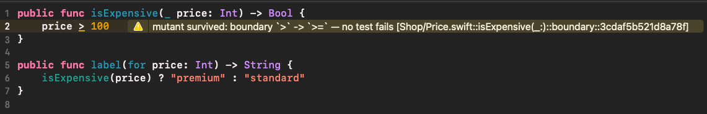

# xcmutate

[](https://github.com/RyoHirota68/xcmutate/releases)
[](https://github.com/RyoHirota68/xcmutate/actions/workflows/ci.yml)
[](docs/install.md#what-you-need)
[](docs/install.md#what-you-need)
[](LICENSE)

**テストが実行しているのに確かめていない Swift のコードを見つけます。**

[English](README.md) | 日本語

xcmutate は、Swift / Xcode プロジェクト向けのミューテーションテストツールです。コードを少しずつ書き換え、書き換えたコードのそれぞれに対してテストを実行し、どのテストも気づかなかった書き換えを一覧にします。そこは、バグがテストをすり抜けうる場所です。

- ミュータントは、コードを1か所だけ書き換えたものです。たとえば `a > b` を `a >= b` にします。
- ミュータントに対してテストが失敗すれば、そのミュータントは Killed（検出）です。そのコードはテストが確かめています。
- テストが全部通れば、そのミュータントは Survived（生き残り）です。テストはそのコードを実行していますが、動作を確かめていません。

XCTest と Swift Testing に対応し、テストは macOS 上か iOS シミュレータ上で実行します。UI テストには対応していません（[必要なもの](#必要なもの)）。

> これは最初のリリースです。オプションやレポートの形式は、1.0 までに変わることがあります。

## コードカバレッジでは分からないこと

Xcode のコードカバレッジが示すのは、テストの実行中にどの行が実行されたかです。その行が変わったときにテストが失敗するかどうかは示しません。関数が2つとテストが1つあるパッケージを例にします。

```swift
// Sources/Shop/Price.swift
public func isExpensive(_ price: Int) -> Bool {
    price > 100
}

public func label(for price: Int) -> String {
    isExpensive(price) ? "premium" : "standard"
}

// Tests/ShopTests/PriceTests.swift
@Test func labels() {
    #expect(label(for: 250) == "premium")
    #expect(label(for: 20) == "standard")
}
```

このテストは `Price.swift` の全行を実行します。`swift test --enable-code-coverage` で測ると、このファイルの行と関数のカバレッジは 100% です。それでも `price > 100` を `price >= 100` に変えると、テストは通ります。どちらの検証も、ちょうど 100 の価格を使っていないためです。xcmutate は、このような変更を見つけます。

このページ以外の文書（`docs/` の下と `CONTRIBUTING.md` など）は英語です。

## インストール

```bash
brew install RyoHirota68/tap/xcmutate
```

ソースからのビルド、リリースのアーカイブ、Mint での入れ方は [docs/install.md](docs/install.md) にあります。

### 必要なもの

- macOS と Xcode（アプリケーション本体）。Command Line Tools だけでは足りません。実行を確認したのは Xcode 27.2 と Xcode 26.6 で、それより古い版は試していません。
- 対象のプロジェクトが git のリポジトリの中にあること。
- `xcodebuild` でテストを実行できる Xcode のプロジェクト・ワークスペース・Swift パッケージ。テストは XCTest か Swift Testing。
- テストの実行先は macOS か iOS シミュレータ。UI テストには対応していません。実機・watchOS・tvOS・visionOS は試していません。

確認済みの組み合わせは [docs/install.md](docs/install.md#what-you-need) に、対応していないことと確かめていないことの一覧は [docs/limitations.md](docs/limitations.md) にあります。

## クイックスタート

### Swift パッケージ

パッケージのディレクトリで、次を実行します。スキーム名は `xcodebuild -list` で分かります。

```bash
xcmutate run --package . --scheme <scheme> --destination 'platform=macOS'
```

上のパッケージでは、レポートの最後は次のようになります。

```
xcmutate 0.13.0: 2 mutants (scope: all)
  Killed 1, Survived 1
  …
Survived / not reached:
  Sources/Shop/Price.swift:2:11 [Survived] boundary `>` -> `>=`  (isExpensive(_:))
    key: Sources/Shop/Price.swift::isExpensive(_:)::boundary::3cdaf5b521d8a78f
```

Survived のミュータントが抜けです。`>` を `>=` に変えても、テストは全部通りました。価格 100 のテストを足したら、`key` を `--only` に渡して、そのミュータントだけを実行し直します。`run` はリポジトリの複製に対して動くので、手元のファイルを書き換えません。

### iOS シミュレータ上のアプリ

先にシミュレータを起動して、起動したままにしておきます。起動していないとミュータント1個ごとに起動し直すので、数倍遅くなります。実際のプロジェクトでは、`--since origin/main` で変更した行だけを対象にします。

```bash
xcrun simctl boot <SIMULATOR-UDID>    # UDID は xcrun simctl list devices で分かる
xcmutate run --since origin/main --workspace App.xcworkspace --scheme App \
  --destination 'id=<SIMULATOR-UDID>' --only-testing AppTests
```

複製には、git が無視するファイルは入りません。git が無視するファイル（`Pods`・手元の `.xcconfig`・生成した Xcode プロジェクトなど）がビルドに要る場合は、`--prepare` で複製の中に作ります。たとえば `--prepare 'xcodegen generate'` です（[docs/usage.md](docs/usage.md#when-the-build-cannot-find-a-file)）。

[docs/getting-started.md](docs/getting-started.md) では、パッケージの例を1つずつ追い、続けてもう少し大きなパッケージとシミュレータ上のアプリを扱います。

## コーディングエージェントに抜けを埋めさせる

上の流れ（実行する → 抜けを読む → テストを書く → 確かめ直す）は、コーディングエージェントに任せられます。エージェント向けの手順はツール自身が出力します。どのエージェントにも、次のようなプロンプトを渡すだけで足ります。

```
Run "xcmutate agent-guide" and follow it to find and close the gaps in the tests
for the changes on this branch. Ask me before you change production code, accept
a mutant as equivalent, or start a run that takes more than 15 minutes.
```

毎回貼りたくない場合は、リポジトリで次を1回実行します。

```bash
xcmutate agent-guide --install
```

プロジェクトに `.claude/` フォルダがあれば Claude Code のスキルを、`.agents/` フォルダがあれば Codex のスキルを書き出します。`AGENTS.md` があれば、そこに短い節を書き足します。`AGENTS.md` は Codex・Cursor・GitHub Copilot が読むファイルです。どれも無ければ `AGENTS.md` を作ります。その後は、エージェントに「ミューテーションテストでテストを確かめて」と頼むだけで足ります。ほかの書き出し先とレポートの形式は [docs/agent-integration.md](docs/agent-integration.md) にあります。

手引きは、エージェントに次のことを指示しています。これらはエージェントへの指示で、ツールが守らせるわけではありません。

- 製品コードを変えない。既存のテストを消さない・スキップしない・弱めない。
- ミュータントを承認する前と、15 分を超える実行を始める前に尋ねる。
- 頼まれない限り、コミット・push・プルリクエストの作成をしない。

小さなパッケージでの試行では、このプロンプトだけを渡したエージェントが、最初の実行の抜け 6 個のうち 4 個をテストを足して埋めました。残りの 2 個は、コメントと実装が食い違う関数と、等価なミュータントの候補でした。エージェントはこの 2 個を報告し、コードを直す前と承認する前に尋ねました（[試行の経過](docs/agent-integration.md#4-an-example-from-a-trial)）。

## ほかにできること

- テキスト・Markdown・HTML・JSON のレポートと、Xcode と GitHub Actions でのソースの該当行への警告（[docs/reports.md](docs/reports.md)）。
- 終了コードで判定する CI 向けのゲートと、GitHub Action（[docs/ci.md](docs/ci.md)）。次の実行は、変更した行のミュータントのスコアが 80% を下回ると、終了コード 4 で失敗します。
  ```bash
  xcmutate run --since origin/main --package . --scheme Shop --destination 'platform=macOS' --fail-under 80
  ```
  `--baseline-report <main ブランチのレポート>` を付けると、main ブランチに無かった抜けがあるときだけ失敗します。
- どのテストも実行していないコードを示す、別の結果（NotReached）。



Run Script のビルドフェーズから `--reporter xcode` を呼ぶと、生き残ったミュータントが Xcode の該当行に警告として出ます（[docs/reports.md](docs/reports.md#report-formats)、[docs/ci.md](docs/ci.md#practical-notes)）。

## 判定をどう確かめているか

ミューテーションテストツールは、誰も気づかないまま間違えることがあります。実際にはテストされていないミュータントを Survived と報告したり、別の理由（前の実行が残したファイルなど）でテストが失敗したミュータントを Killed と報告したりします。どちらの場合も、スコアは同じように見えます。

そこで xcmutate は、根拠があるときだけ判定を出します。Survived には、テストの実行中にそのミュータントが有効になったという記録と、テストが全部実行されたことが必要です。Killed には、同じテストがその前にミュータント無しで通っていることが必要です。速い方式では答えが変わりうる場合は、報告の前に、遅い方式でそのミュータントを実行し直します。判定できなかったミュータントは、そのとおりに報告してスコアに数えません。その実行は終了コード 7 で終わります。

正確な条件と、それを変えるオプションは [docs/verification.md](docs/verification.md#what-each-verdict-needs) にあります。同じページに、判定を何と突き合わせて確かめているか（464 件の期待値を持つ検証用アプリなど）があります。

## どのくらい速いか

ミュータント1個あたりの時間は、それを検出しうるテストを1回実行する時間と、テストのプロセスの起動でほぼ決まります。このため、小さなパッケージと大きなアプリでは桁が1つ違います。下の数値は、条件と一緒に読んでください。版 0.13.0 を、ほかのビルドも動いていた1台の Mac で測ったもので、ほとんどは1回だけの計測です。

| プロジェクト | ミュータント1個ごとに実行するテスト | オプション | ミュータント1個あたりの時間 |
|---|---|---|---|
| 上のパッケージ（`isExpensive`、macOS） | 1 件、1 秒未満 | 既定 | 2.0 秒 |
| | | `--shared-process` | 0.3 秒 |
| 小さな iOS アプリ（シミュレータ上でアプリをホストにしたユニットテスト） | 105 件、0.2 秒 | 既定 | 11.0 秒 |
| | | `--shared-process` | 1.4 秒 |
| 大きな製品 iOS アプリ（シミュレータ） | 約 1,200 件、約 45 秒 | `--select-tests reach --shared-process` | 22〜24 秒 |

選択したテストが長いときと、生き残るミュータント・クラッシュさせるミュータント・終わらないミュータントが多いときは遅くなります。大きなアプリ全体を一度に対象にするのは現実的ではありません。`--since`、夜間の実行、`--max-mutants` による抽出を使ってください。計測値と、それぞれのオプションがどういうときに速くなるかは [docs/speed.md](docs/speed.md) にあります。

`--shared-process` は、ミュータントごとにテストを起動し直さず、1つのテストプロセスの中で多くのミュータントを実行します。既定で無効なのは、テストが同じプロセスの中で2回続けて通る必要があるためです。

## Muter との違い

Swift のミューテーションテストツールとしては [Muter](https://github.com/muter-mutation-testing/muter) が広く使われています。xcmutate は、Muter の設計・issue・テストデータから学びました。Muter の README に書かれていることと比べると、xcmutate には次の違いがあります。

- 差分の行を書き換えの対象にします（`--since`）。Muter の README では、ファイル単位で選びます。
- どのテストも実行していないコード（NotReached）と、書き換えてもテストが気づかないコード（Survived）を分けて報告し、自分の判定を確かめます。
- 「新しい抜けを増やしていないか」を判定する CI 向けのゲート（`--baseline-report`）、承認した等価なミュータントのファイル、コーディングエージェント向けのレポートがあります。

実績の長いツールを使いたい場合、UI テスト・tvOS・watchOS が必要な場合、テストを `xcodebuild` 以外で起動している場合は、Muter のほうが向いています。この比較のために Muter を実行してはいないので、速さの比較はありません。詳細と根拠は [docs/comparison.md](docs/comparison.md) にあります。

## 文書

| ページ | 内容 |
|---|---|
| [Getting started](docs/getting-started.md) | 最初の実行、レポートの読み方、抜けの埋め方 |
| [Usage reference](docs/usage.md) | すべてのサブコマンド（`run`・`accept`・`clean`・`list`・`instrument`）とオプション、用語集 |
| [Limitations](docs/limitations.md) | 対応していないこと、まだ確認できていないこと、既知の問題 |
| [Reports](docs/reports.md) | 結果の種類、スコア、レポートの形式、警告、ゲートと終了コード |
| [Configuration](docs/configuration.md) | 設定ファイル、どのファイルを書き換えるか、無効化コメント |
| [Operators](docs/operators.md) | 27 個のミューテーション演算子（既定で有効なのは 19 個）と、既定を決める基準 |
| [Speed](docs/speed.md) | 計測値と、実行を速くする方法 |
| [CI](docs/ci.md) | GitHub Action、ワークフローの例、シェルスクリプト、時間の予算 |
| [How it works](docs/how-it-works.md) | 設計の目標、埋め込みの仕組み、自己検査 |
| [Verification](docs/verification.md) | 各判定に必要な条件と、判定を何と突き合わせて確かめているか |
| [Comparison](docs/comparison.md) | Muter との違いと、その根拠 |
| [Agents](docs/agent-integration.md) | プロンプト、手順（`agent-guide`）、`agent-guide --install` が書き出すファイル、コーディングエージェント向けのレポート |
| [Contributing](CONTRIBUTING.md)、[Changelog](CHANGELOG.md) | ビルドの方法と、変更ごとに実行する確認。版ごとの変更 |

## ライセンスと謝辞

[MIT](LICENSE)。依存しているソフトウェアのライセンスと出典は [THIRD_PARTY_NOTICES.md](THIRD_PARTY_NOTICES.md) にまとめています。

- [mizchi/mutator](https://github.com/mizchi/mutator): 差分を起点にする設計、ミュータントの安定キー、エージェント向けのレポート、スキルの原型。
- [Muter](https://github.com/muter-mutation-testing/muter): Swift での mutant schemata の方式と、このツールの確認に使っているテストデータ。
- [ericodx/swift-mutation-testing](https://github.com/ericodx/swift-mutation-testing): テストごとに到達を記録する考え方。
- [debugholic/litmus](https://github.com/debugholic/litmus): テストを繰り返すドライバを使い、1つのテストプロセスで多くのミュータントを実行する考え方。
- [mutation-testing-elements](https://github.com/stryker-mutator/mutation-testing-elements)（Stryker）: レポートのスキーマと HTML の表示部品。
