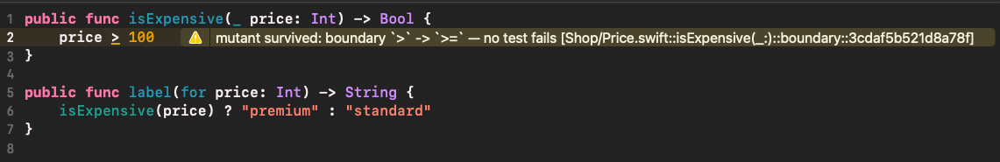

# xcmutate

[](https://github.com/RyoHirota68/xcmutate/releases)
[](https://github.com/RyoHirota68/xcmutate/actions/workflows/ci.yml)
[](docs/install.md#what-you-need)
[](docs/install.md#what-you-need)
[](LICENSE)

**Find the Swift code that your tests run but do not check.**

English | [日本語](README.ja.md)

xcmutate is a mutation testing tool for Swift and Xcode projects. It changes your code in small ways, runs your tests against each change, and lists the changes that no test noticed. Those are the places where a bug could get past your tests.

- A *mutant* is a copy of your code with one small change, for example `a > b` turned into `a >= b`.
- A mutant is *Killed* when a test fails on it. Your tests check that code.
- A mutant has *Survived* when every test still passes. Your tests run that code but do not check what it does.

It works with XCTest and Swift Testing, on macOS and iOS simulators. UI tests are not supported ([What you need](#what-you-need)).

> This is an early version (0.15.0; the first release was 0.13.0). Options and report formats may still change before 1.0.

## What code coverage does not show

Code coverage, as Xcode shows it, tells you which lines ran during the tests. It does not tell you whether any test would fail if one of those lines changed. Take a package with two functions and one test:

```swift
// Sources/Shop/Price.swift
public func isExpensive(_ price: Int) -> Bool {
    price > 100
}

public func label(for price: Int) -> String {
    isExpensive(price) ? "premium" : "standard"
}

// Tests/ShopTests/PriceTests.swift
@Test func labels() {
    #expect(label(for: 250) == "premium")
    #expect(label(for: 20) == "standard")
}
```

The test runs every line of `Price.swift`: `swift test --enable-code-coverage` reports 100% of its lines and functions covered. It still passes when `price > 100` is changed to `price >= 100`, because neither assertion uses a price of exactly 100. xcmutate finds changes like this one.

## Installation

```bash
brew install RyoHirota68/tap/xcmutate
```

[docs/install.md](docs/install.md) covers building from source, the release archive and Mint.

### What you need

- macOS with Xcode, the full application. The Command Line Tools alone are not enough. Runs were verified with Xcode 27.2 and Xcode 26.6; older versions have not been tried.
- The project in a git repository.
- An Xcode project, workspace or Swift package whose tests `xcodebuild` can run, with XCTest or Swift Testing.
- Tests on macOS or on an iOS simulator. UI tests are not supported. Physical devices, watchOS, tvOS and visionOS have not been tried.

[docs/install.md](docs/install.md#what-you-need) has the tested combinations, and [docs/limitations.md](docs/limitations.md) lists everything that is not supported or not verified.

## Quick start

### Set up a project with init

`xcmutate init` tries the project and writes the options for later runs into a config file. For an app, boot a simulator first and leave it running; for a Swift package, run `xcmutate init` alone in the package directory. Add `--scheme <name>` when the project has more than one scheme.

```bash
xcrun simctl boot <SIMULATOR-UDID>    # the UDID from xcrun simctl list devices
xcmutate init --destination 'id=<SIMULATOR-UDID>'
```

`init` finds the workspace, project or package, its scheme and its unit-test targets. It then runs a sample of mutants (10 by default) twice, in the default mode and in the faster modes, and writes `xcmutate.yml` with a `run` object and the profiles `pr` and `nightly`, each choice with its reason as a comment. A faster mode goes into a profile only when it gave the same verdicts as the default mode and took less time per mutant. `init` builds the project at least three times and runs the tests for each mutant of the sample, so on a large app it takes several minutes or more. [docs/usage.md](docs/usage.md#init) describes what it writes and when it refuses to overwrite a file.

Then, on a branch:

```bash
xcmutate run --profile pr
```

The `pr` profile mutates the lines changed since the default branch (`origin/main`, for example, when `init` found one). On a branch that added the package above, the report ends like this:

```
xcmutate 0.15.0: 2 mutants (scope: diff)
  Killed 1, Survived 1
  …
Survived / not reached:
  Sources/Shop/Price.swift:2:11 [Survived] boundary `>` -> `>=`  (isExpensive(_:))
    key: Sources/Shop/Price.swift::isExpensive(_:)::boundary::3cdaf5b521d8a78f
```

The Survived mutant is a gap: with `>` changed to `>=`, every test still passed. Add a test for a price of 100, then pass the `key` to `--only` to run that mutant again. `run` works on a copy of the repository and does not modify your files.

### Run without a config file

All options can also be given on the command line. For a Swift package, in the package directory (`xcodebuild -list` shows the scheme name):

```bash
xcmutate run --package . --scheme <scheme> --destination 'platform=macOS'
```

For an app on an iOS simulator, boot the simulator first and leave it running; otherwise every mutant boots it again, which is several times slower. `--since origin/main` mutates only the lines you changed:

```bash
xcrun simctl boot <SIMULATOR-UDID>
xcmutate run --since origin/main --workspace App.xcworkspace --scheme App \
  --destination 'id=<SIMULATOR-UDID>' --only-testing AppTests
```

The copy leaves out files that git ignores. If the build needs some of them, such as `Pods`, a local `.xcconfig` or a generated Xcode project, create them in the copy with `--prepare`, for example `--prepare 'xcodegen generate'` ([docs/usage.md](docs/usage.md#when-the-build-cannot-find-a-file)).

[docs/getting-started.md](docs/getting-started.md) goes through the package example step by step, then a larger package and an app on a simulator.

## Let a coding agent close the gaps

The loop above (run, read the gaps, write a test, check again) is one that a coding agent can do. The tool prints the procedure for the agent itself, so a prompt like this is enough for any agent:

```
Run "xcmutate agent-guide" and follow it to find and close the gaps in the tests
for the changes on this branch. Ask me before you change production code, accept
a mutant as equivalent, or start a run that takes more than 15 minutes.
```

If you do not want to paste it every time, run this once in the repository:

```bash
xcmutate agent-guide --install
```

If the project has a `.claude/` folder, the command writes a Claude Code skill, and for an `.agents/` folder a Codex skill. If it has an `AGENTS.md`, the file that Codex, Cursor and GitHub Copilot read, the command adds a short section to it. If it has none of these, the command creates `AGENTS.md`. After that, asking the agent to check the tests with mutation testing is enough. [docs/agent-integration.md](docs/agent-integration.md) has the other places it can write to and the report format.

The guide tells the agent not to change production code, not to delete, skip or weaken tests, and not to commit, push or open a pull request unless you asked. It tells the agent to ask before it accepts a mutant or starts a run over 15 minutes. These are instructions to the agent; the tool does not enforce them.

In a trial on a small package, an agent given only this prompt closed 4 of the 6 gaps of the first run with new tests. It reported the other two, a function whose comment contradicted its code and a candidate equivalent mutant, and asked before it changed code or accepted the mutant ([the trial](docs/agent-integration.md#4-an-example-from-a-trial)).

## What else it does

- Reports as text, Markdown, HTML and JSON, and as warnings on source lines in Xcode and GitHub Actions ([docs/reports.md](docs/reports.md)).
- Gates with exit codes for CI, and a GitHub Action ([docs/ci.md](docs/ci.md)). This run fails with exit code 4 when the mutants on the changed lines score below 80%:
  ```bash
  xcmutate run --since origin/main --package . --scheme Shop --destination 'platform=macOS' --fail-under 80
  ```
  With `--baseline-report <report of the main branch>` it fails only for gaps that the main branch did not have.
- A separate result, *NotReached*, for code that no test runs at all.



`--reporter xcode`, called from a Run Script build phase, shows survived mutants as warnings on their lines in Xcode ([docs/reports.md](docs/reports.md#report-formats), [docs/ci.md](docs/ci.md#practical-notes)).

## How it checks its own verdicts

A mutation testing tool can be wrong without anyone noticing. It can report a mutant as Survived that was never really tested, or as Killed when the test failed for another reason, such as a file left by the previous run. The score looks the same.

xcmutate therefore gives a verdict only with evidence. For a Survived it needs a record that the mutant was switched on while the tests ran, and a full test count. For a Killed it needs the same tests to have passed without mutants beforehand. Where a faster mode could give a different answer, it runs the mutant again in the slower way before it reports it. A mutant that it could not judge is reported as such and is not counted, and the run then ends with exit code 7.

[docs/verification.md](docs/verification.md#what-each-verdict-needs) lists the exact conditions and the options that change them. The same page says what the verdicts are checked against (a fixture app with 464 expected results, among other things).

## How fast it is

The time per mutant is mostly the time of one run of the tests that can detect it, plus the launch of the test process. So a small package and a large app differ by an order of magnitude, and the numbers below must be read with their conditions. The table was measured with version 0.13.0 on one Mac that was running other builds, mostly in single runs.

| Project | Tests run per mutant | Options | Time per mutant |
|---|---|---|---|
| The package above (`isExpensive`), on macOS | 1 test, under a second | default | 2.0 s |
| | | `--shared-process` | 0.3 s |
| A small iOS app, unit tests hosted by the app on a simulator | 105 tests, 0.2 s | default | 11.0 s |
| | | `--shared-process` | 1.4 s |
| A large production iOS app, on a simulator | about 1,200 tests, about 45 s | `--select-tests reach --shared-process` | 22 to 24 s |

The same large app was measured again with 0.15.0, on 33 mutants, one run of each setting at a time when the Mac had little else to do. The times are for the whole run.

| Version | Options | Whole run |
|---|---|---:|
| 0.13.0 | `--select-tests reach --shared-process` | 1,162 s |
| 0.15.0 | `--select-tests reach --shared-process` | 1,147 s |
| 0.15.0 | `--select-tests reach --shared-process --confirm-kills restore` | 984 s |

With `--confirm-kills restore`, 9 of the 12 runs without mutants after a detection were replaced by putting the simulator back. The four runs of this comparison gave the same verdicts: 28 Killed and 5 Crash.

A run is slow when the selected tests are long, or when many mutants survive, crash or hang. Mutating a whole large app in one go is not practical; use `--since`, a nightly run, or a sample with `--max-mutants`. [docs/speed.md](docs/speed.md) has the measurements and says when each option helps.

`--shared-process` runs many mutants in one test process instead of launching the tests for each. It is off by default because it needs tests that pass twice in a row in one process. `--shared-process auto` uses it only when the baseline's times say that it saves time for the number of mutants.

For an app whose tests take many minutes, the steps that run all tests dominate. `--select-tests impact` chooses the tests of a pull request from a map that a nightly run wrote (the results then hold among those tests), `--stop-when-gate-decided` ends a CI run as soon as its gate's result is known, and `--confirm-kills restore` puts the simulator back instead of running the tests after a detection. [docs/speed.md](docs/speed.md) says what each costs and assumes.

## How it differs from Muter

[Muter](https://github.com/muter-mutation-testing/muter) is the established mutation testing tool for Swift, and xcmutate learned from its design, its issue tracker and its test data. Compared with what Muter's README describes, xcmutate:

- mutates the lines of a diff (`--since`). Muter's README selects whole files.
- reports code that no test runs (NotReached) separately from code whose change the tests miss (Survived), and checks its own verdicts.
- has a CI gate for "no new gaps" (`--baseline-report`), a file of accepted equivalent mutants and a report for coding agents.

Muter is the better choice if you want a tool with a longer history, need UI tests, tvOS or watchOS, or start your tests with something other than `xcodebuild`. Muter was not run for this comparison, so there is no speed comparison. [docs/comparison.md](docs/comparison.md) has the details and their sources.

## Documentation

| Page | Content |
|---|---|
| [Getting started](docs/getting-started.md) | A first run, reading the report, closing a gap |
| [Usage reference](docs/usage.md) | Every subcommand (`run`, `init`, `accept`, `clean`, `list`, `instrument`) and all options, with a glossary; the keys of the config file |
| [Limitations](docs/limitations.md) | What is not supported, what has not been verified yet, and known issues |
| [Reports](docs/reports.md) | Result kinds, scores, report formats, warnings, gates and exit codes |
| [Configuration](docs/configuration.md) | The config file (`xcmutate.yml`), which files are mutated, disable comments |
| [Operators](docs/operators.md) | The 27 mutation operators (19 on by default) and the rule behind the defaults |
| [Speed](docs/speed.md) | Measurements, and what makes a run faster |
| [CI](docs/ci.md) | The GitHub Action, example workflows, a shell script, time budgets |
| [How it works](docs/how-it-works.md) | Design goals, the instrumentation, the self-checks |
| [Verification](docs/verification.md) | What each verdict needs, and what the verdicts are checked against |
| [Comparison](docs/comparison.md) | How the tool differs from Muter, with sources |
| [Agents](docs/agent-integration.md) | The prompt, the guide (`agent-guide`), the Claude Code skill, and the report for coding agents |
| [Contributing](CONTRIBUTING.md), [Changelog](CHANGELOG.md) | Building, the checks to run for a change; changes per version |

## License and acknowledgements

[MIT](LICENSE). Third-party licenses and sources are listed in [THIRD_PARTY_NOTICES.md](THIRD_PARTY_NOTICES.md).

- [mizchi/mutator](https://github.com/mizchi/mutator): the diff-driven design, stable mutant keys, the agent report and the original of the agent skill.
- [Muter](https://github.com/muter-mutation-testing/muter): the mutant schemata approach for Swift, and the test data this tool is checked against.
- [ericodx/swift-mutation-testing](https://github.com/ericodx/swift-mutation-testing): the idea behind recording reach per test.
- [debugholic/litmus](https://github.com/debugholic/litmus): the idea of running many mutants in one test process with a driver that repeats the tests.
- [mutation-testing-elements](https://github.com/stryker-mutator/mutation-testing-elements) (Stryker): the report schema and the HTML viewer.
